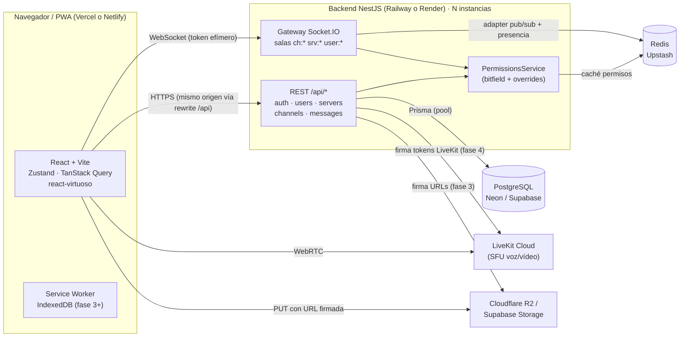

# 1. Arquitectura general

## Diagrama

## Decisiones clave

| Decisión | Por qué |
|---|---|
| **Monolito modular NestJS** (no microservicios) | Un solo proceso por instancia = menos RAM, despliegue trivial en Railway/Render. Los módulos (`auth`, `servers`, `channels`, `messages`, `realtime`…) tienen fronteras claras para separarlos si algún día hace falta. |
| **REST para escrituras, WebSocket solo para difusión** | Las escrituras pasan por HTTP (validación, rate limit, CSRF, reintentos idempotentes con `nonce`). El socket solo empuja eventos: el gateway queda simple y sin estado → escala horizontal con el adapter de Redis. |
| **Salas por visibilidad** | Cada socket entra en `user:<id>` y `srv:<id>` (eventos ligeros: `CHANNEL_ACTIVITY`, cambios de canales, presencia) y **solo en el canal visible** `ch:<id>` (payload completo de mensajes). Un usuario en 30 servidores no recibe el tráfico de 30 servidores. |
| **Token de socket efímero (60 s)** | El frontend (Vercel) y la API (Railway) están en dominios distintos. HTTP va por rewrite al mismo origen (cookies `SameSite=Lax`), pero WebSocket no se puede reescribir en Vercel: el cliente pide `/api/auth/socket-token` (con su cookie) y se conecta directo con ese JWT de audiencia `ws`. Sin cookies de terceros. |
| **Access JWT 15 min + refresh opaco rotativo** | Access en cookie httpOnly; refresh `<sessionId>.<secreto>` guardado como hash SHA-256, rotado en cada uso, con detección de reutilización (revoca todas las sesiones) y 30 s de gracia para pestañas concurrentes. |
| **CSRF double-submit** | Cookie `csrf_token` legible + cabecera `x-csrf-token` en cada mutación. Peticiones con `Authorization: Bearer` (bots) no lo necesitan. |
| **IDs UUIDv7** | Ordenables por tiempo: el cursor de paginación es el propio `id`. El índice `(channel_id, id)` equivale a `(channel_id, created_at)` pero es único y estable (no hay empates de timestamp). |
| **Permisos por bits (BigInt)** | Mismo algoritmo en backend y frontend (`packages/shared`). El servidor siempre recalcula; el cliente solo lo usa para ocultar botones. Cacheado en Redis (TTL 5 min + invalidación). |
| **Zod compartido** | Un esquema valida en el formulario y en la API (`ZodPipe`). Menos código que class-validator y un único origen de verdad. |
| **Redis opcional en local** | Sin `REDIS_URL` se usa caché en memoria y adapter en memoria: `pnpm dev` funciona solo con Node + Postgres. En producción, Upstash. |
| **Markdown propio sin `innerHTML`** | Renderer de ~80 líneas que produce nodos React: imposible inyectar HTML (XSS) y 0 KB de dependencias. |
| **LiveKit Cloud** | El backend solo firma tokens; el SFU no consume CPU del servidor. El SDK de LiveKit se carga con `import()` solo al entrar a un canal de voz. |

## Presupuestos de rendimiento (verificables)

| Métrica | Objetivo | Cómo medirlo |
|---|---|---|
| JS inicial (gzip) | < 200 KB | `pnpm --filter @ezydc/web build` imprime tamaños gzip por chunk |
| API p95 | < 80 ms | `GET /api/metrics` (`http.p95Ms`) |
| Latencia WebSocket | < 100 ms | indicador en el panel de usuario (ping `sys:ping` cada 30 s) |
| RSS API en reposo | < 150 MB | `GET /api/metrics` (`memory.rssMb`) |
| Mensajes renderizados en DOM | ~30–60 aunque el canal tenga miles | virtualización (react-virtuoso) |
