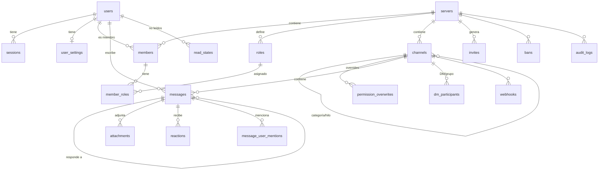

# 2. Esquema de base de datos

La fuente de verdad es [`apps/api/prisma/schema.prisma`](../apps/api/prisma/schema.prisma). Está **completo para todas las fases**; la Fase 1 solo escribe en una parte.

## Diagrama entidad-relación (núcleo)



## Tablas

| Tabla | Propósito | Fase |
|---|---|---|
| `users`, `sessions`, `user_settings` | Cuentas, refresh tokens (hash), tema/acento/fuente | 1 (2FA: `totp_*` fase 2) |
| `servers`, `members`, `roles`, `member_roles` | Servidores y jerarquía de roles. `@everyone` tiene `id = server.id` | 1–2 |
| `channels` | Texto, voz, anuncios, categorías (`type=CATEGORY` + `parent_id`), DMs, grupos e hilos | 1 / 3 |
| `permission_overwrites` | `allow`/`deny` por rol o miembro en un canal | 2 |
| `dm_participants`, `relationships` | DMs, grupos privados, amigos/bloqueos | 3 |
| `messages`, `attachments`, `reactions`, `message_*_mentions` | Mensajería | 1 / 3 |
| `emojis` | Emojis personalizados por servidor | 3 |
| `invites` | Códigos de invitación con usos/expiración | 1 |
| `read_states`, `notification_settings`, `push_subscriptions` | No leídos, silenciar, Web Push | 3 |
| `bans`, `audit_logs`, `word_filters` | Moderación | 5 |
| `applications`, `webhooks` | Bots y webhooks entrantes | 5 |

## Índices y por qué

| Índice | Consulta que sirve |
|---|---|
| `messages (channel_id, id DESC)` | Historial paginado por cursor: `WHERE channel_id=$1 AND id < $cursor ORDER BY id DESC LIMIT 50`. Como `id` es UUIDv7 (prefijo de timestamp), equivale a `(channel_id, created_at)` sin empates. |
| `messages (author_id, id DESC)` | Filtro `from:` en búsqueda y "borrar mensajes de los últimos N días" al banear. |
| `members (server_id, user_id)` PK + `members (user_id)` | Comprobar membresía (O(1)) y listar "mis servidores". La PK pagina miembros por cursor. |
| `channels (server_id, position)` | Lista ordenada de canales en una sola lectura. |
| `roles (server_id, position)` | Jerarquía de roles. |
| `message_user_mentions (user_id, message_id DESC)` | Bandeja de menciones. |
| `audit_logs (server_id, id DESC)` | Registro de auditoría paginado. |
| `channels.last_message_id` | Saber si hay no leídos comparando con `read_states.last_read_message_id`, **sin** `COUNT(*)`. |

## Paginación por cursor

Nunca `OFFSET`. El cliente envía `before=<id>` (scroll hacia arriba) o `after=<id>` (sincronización tras reconexión). Coste constante sin importar la profundidad.

## Búsqueda full-text (Fase 5)

Prisma no gestiona columnas generadas, así que se añade con una migración SQL manual (`prisma migrate dev --create-only`):

```sql
ALTER TABLE messages
  ADD COLUMN search tsvector
  GENERATED ALWAYS AS (to_tsvector('simple', unaccent_immutable(content))) STORED;
CREATE INDEX messages_search_idx ON messages USING GIN (search);
```

Las consultas usan `$queryRaw` con `websearch_to_tsquery` + filtros por `author_id`, `channel_id` y rango de `id` (las fechas se convierten a límites UUIDv7).

## Archivado de mensajes antiguos (Fase 5)

Tabla `messages_archive` con la misma estructura. Un job (cron de Railway/Render, sin PM2) mueve en lotes mensajes con `id < uuidv7(now() - 12 meses)`:

```sql
WITH moved AS (
  DELETE FROM messages WHERE id IN (
    SELECT id FROM messages WHERE id < $limite ORDER BY id LIMIT 5000
  ) RETURNING *)
INSERT INTO messages_archive SELECT * FROM moved;
```

La API consulta el archivo solo cuando el cursor cruza el límite. Alternativa con más volumen: particionar `messages` por rango de `id` (mensual).

## Pool de conexiones

- **Neon**: `DATABASE_URL` con host `-pooler` y `?pgbouncer=true&connection_limit=5`; `DIRECT_URL` sin pooler para migraciones.
- **Supabase**: puerto `6543` (Supavisor, modo transacción) con `?pgbouncer=true&connection_limit=5`; `DIRECT_URL` al puerto `5432`.
- `connection_limit` por instancia × nº de instancias < límite del plan.
